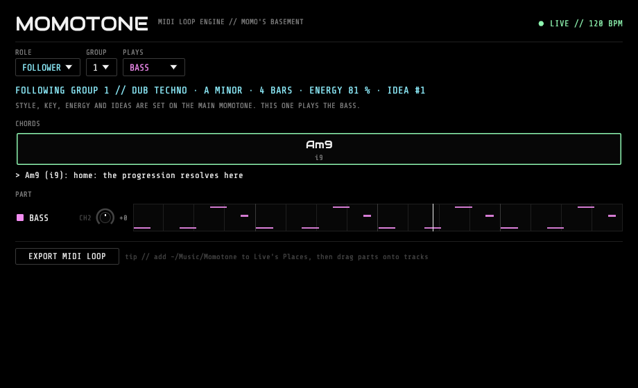

# Momotone

**A MIDI loop generator by [Momo's Basement](https://momosbasement.com).** Pick a style and a key, set the energy, press play.
Momotone writes chords, bass, an arpeggio and a melody that all fit together, locked to your DAW's tempo, each on its own MIDI channel, so every part can drive a different machine.

No music theory needed. Every chord comes with a short note in plain words on what it does.

VST3 + CLAP, written in Rust with [nih-plug](https://github.com/robbert-vdh/nih-plug). Works in Ableton Live, Bitwig, Reaper, FL Studio, Cubase, Studio One and other VST3/CLAP hosts, on macOS, Windows and Linux.

## Styles

36 electronic styles in 9 families. Each one sets the scale, the chord progressions that suit it, the swing and a groove for every part:

| Family | Styles |
|---|---|
| House | House, Deep House, Tech House, Afro House, Amapiano |
| Techno | Techno, Minimal, Dub Techno, Detroit Techno, Acid, Hard Techno |
| Trance | Trance, Progressive, Psytrance |
| UK & Bass | UK Garage, Bassline, Drum & Bass, Liquid DnB, Jungle, Dubstep |
| Breaks & Electro | Breakbeat, Electro, Footwork / Juke |
| Disco & Funk | Disco / Nu-disco, Italo Disco, Funk / Boogie, Soul |
| Dub & Roots | Dub / Reggae, Dancehall |
| Downtempo | Ambient, Trip-hop, Lo-fi Hip-hop, Downtempo / Chill, IDM, Synthwave |
| Hard | Hardcore / Gabber |

The plugin follows your project tempo; each style's typical tempo (shown in the style menu) is what the `.mid` export uses when there's no host tempo. `momotone styles` lists them all.

## The screen


- **Style / Key / Bars**: dropdowns. The style menu is grouped by family and shows each style's tempo; the scale comes with the style.
- **Energy** knob: *laid back* → *peak time*. **Idea** knob: browse ideas; ◀ ▶ step one by one, **New idea** jumps to a random one. Knobs: drag up/down, Shift for fine, double-click to reset.
- **Chords**: hover a chord to read what it does; the one playing is outlined in mint.
- **Parts**: click the name to switch a part on/off, small knob = octave, then its notes with the playhead.
- **Role / Group**: main or follower (see the workflow below).
- **Export MIDI loop**: writes a folder to `~/Music/Momotone/` (style, key, tempo, energy, idea) with one `.mid` per part plus `All parts.mid`. Add that folder to Live's *Places* once and every export shows up in the browser.

No DAW at hand? `cargo run --release -p momotone-plugin --features standalone` opens the same screen as an app.

Fonts: [Audiowide](https://fonts.google.com/specimen/Audiowide) and [Share Tech Mono](https://fonts.google.com/specimen/Share+Tech+Mono), both under the SIL Open Font License (`crates/momotone-plugin/assets/fonts/`).

## Parameters

| Parameter | What it does |
|---|---|
| Role | **Main** (you play it) or **Follower** (plays one part of its group's main) |
| Link group | 1..4: a follower follows the main of the same group |
| Follower part | The part a follower plays: Chords, Bass, Arp or Melody |
| Style | One of the 36 styles above: harmony, grooves and swing (shown by name in the DAW) |
| Key | Root note. The style picks the scale |
| Energy | 0 % sparse and laid back → 100 % busy and peak-time. It only adds or removes ghost notes and fills; the core groove never moves |
| Variation | 1..500. Each number is a different idea. Saved with your project, so you can always get it back |
| Bars | Loop length, 1..8 |
| Chords / Bass / Arp / Melody | Turn parts on or off. Muting one never changes the others |
| *Part* octave | Shift each part ±3 octaves to fit each machine's range |
| One channel per part | On (default): chords ch 1, bass ch 2, arp ch 3, melody ch 4. Off: everything on ch 1. Useful in hosts that can split channels (Bitwig, Reaper); in Live, use followers |

New settings come in on the next bar line, like launching a clip, so you can tweak while it plays.

## Studio workflow (Ableton Live + Push + hardware)

One **Main** Momotone is where you play: style, key, energy, ideas. Each other part gets a small **Follower** Momotone that plays just that part of the main's loop, in sync, so every synth or machine gets its own track. Live can't split MIDI channels between tracks, which is why followers exist.



1. **Main track**: a MIDI track with Momotone. Leave it on **Main**, group **1**.
2. **One follower track per part** (for example Bass → MS-1, Chords → Prophet):
   - a MIDI track with Momotone, set to **Follower**, group **1**, and **Plays: Bass** (or Chords, Arp, Melody);
   - a second MIDI track for the sound: *MIDI From* = the follower track, then **Momotone**; *Monitor* = **In**; device = your synth, or Live's **External Instrument** pointing at the machine's MIDI port and audio return.
3. Press play and find a loop on the main (map Style / Energy / Variation to Push encoders). Followers change on the same bar as the main.
4. **Record the audio** of each machine into clips, then play them from the Push.

The main can play parts too (its own Chords / Bass / Arp / Melody switches), so a minimal setup is: main → chords synth, one follower → bass machine.
Use groups 2–4 to run separate Momotone setups in the same set. Only one Main per group: the screen warns you if there are two.

Prefer files? **Export MIDI loop** writes one `.mid` per part; drag them onto the tracks or Push clip slots.

In Bitwig or Reaper you can also put Momotone directly in front of a synth on the same track.

## Build

```sh
cargo test --workspace                                  # engine + playback tests
cargo xtask bundle momotone-plugin --release            # Windows / Linux
cargo xtask bundle-universal momotone-plugin --release  # macOS (Intel + Apple Silicon)
```

Bundles land in `target/bundled/` (`Momotone.vst3`, `Momotone.clap`). Copy them to:

| OS | VST3 | CLAP |
|---|---|---|
| macOS | `~/Library/Audio/Plug-Ins/VST3` | `~/Library/Audio/Plug-Ins/CLAP` |
| Windows | `C:\Program Files\Common Files\VST3` | `C:\Program Files\Common Files\CLAP` |
| Linux | `~/.vst3` | `~/.clap` |

On macOS, unsigned plugins are blocked the first time; clear the flag with
`xattr -dr com.apple.quarantine ~/Library/Audio/Plug-Ins/VST3/Momotone.vst3`.

Every push runs `.github/workflows/build.yml`: tests, then macOS universal, Windows and Linux bundles as downloadable artifacts.

## Command line (audition without a DAW)

```sh
cargo run -p momotone-engine --bin momotone -- styles
cargo run -p momotone-engine --bin momotone -- gen --style ukg --key F --energy 0.7 --seed 4 --layers all -o idea.mid
cargo run -p momotone-engine --bin momotone -- spec demos/ai-spec-example.json --layers all -o idea.mid
cargo run -p momotone-engine --bin momotone -- prompt   # the LLM system prompt
```

`.mid` files have one track per part, so dropping one into Live creates separate tracks. `demos/` has examples.

## How it works

```
crates/momotone-engine   pure Rust, no audio deps (CLI, tests, WASM later)
  pitch, scale           notes, 7 modes, scale stepping
  chord                  Roman numerals: "i9", "bVImaj7", "IV7", "ii°" ...
  voicing                voice leading: each chord moves the fewest semitones from the last
  grid                   groove grids with energy thresholds (see below)
  style                  the genres: mode, proven progressions, swing, one grid per part
  generate               chords / bass / arp / melody, deterministic per seed
  explain                "why this works" lines
  spec                   JSON contract for the AI layer + its system prompt
  midi                   Standard MIDI File writer
crates/momotone-plugin   nih-plug wrapper
  params                 host-automatable parameters
  player                 loops the pattern against the host transport, sample-accurate
  lib                    background rendering, bar-quantized swaps, no allocation on the audio thread
```

**Groove grids.** A style's rhythm is written as text, one character per 16th note:

```
UK garage chords   "...0..1...0..2.6"
UK garage bass     "0..3..1.....2.4.0..3..1...5.2..7"   (2 bars)
            tones  "r..8..5.....r.a.r..8..5...3.r..a"   root, octave, fifth, third, approach...
```

`.` is a rest; a digit is a hit that plays when Energy × 10 ≥ that digit. `0` is the core groove; higher digits are ghost notes and fills. Swing pushes the off-beat 16ths late. Adding a genre means writing a few of these lines.

**Melody.** A one-bar motif is picked from the style's melody positions, then stated, answered with a varied contour, contrasted, and resolved home on the last bar. Notes on beats 1 and 3 are always chord tones, and over borrowed chords the clashing scale notes are swapped for the chord's own.

**AI layer.** The LLM never writes notes. It turns a vibe ("rainy-night garage, a bit soulful") into a small JSON spec (key, mode, Roman-numeral progression, style, energy, one-sentence explanation). The engine validates it and renders it with the style's grooves, so the output is always playable and editable.

## Roadmap

- [x] Custom UI: style buttons, energy fader, chord strip, "New idea", piano-roll preview, MIDI export
- [ ] Drag a part from the plugin straight onto a DAW track (native OS drag, macOS first)
- [ ] AI prompt box (LLM call from a background thread)
- [ ] Lock a part or a bar you like and regenerate the rest
- [ ] Per-part MIDI channel and velocity curves, humanize
- [ ] Drum part (kick/snare/hats grids per style) for drum machines
- [ ] Follow mode: play a note on the Push to set the key live

## License

GPL-3.0-or-later. nih-plug's VST3 bindings are GPLv3, so distributed VST3 builds must be GPLv3.
To ship closed-source, release CLAP only or move the VST3 wrapper to the official SDK.
