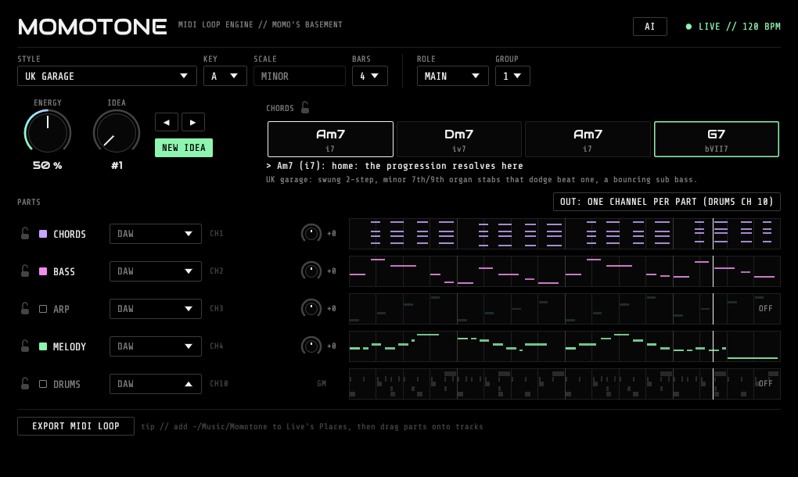

# Momotone

**A MIDI loop generator by [Momo's Basement](https://momosbasement.com).** Pick a style and a key, set the energy, press play.
Momotone writes chords, bass, an arpeggio and a melody that all fit together, locked to your DAW's tempo, each on its own MIDI channel, so every part can drive a different machine.

No music theory needed. Every chord comes with a short note in plain words on what it does.

VST3 + CLAP, written in Rust with [nih-plug](https://github.com/robbert-vdh/nih-plug). Works in Ableton Live, Bitwig, Reaper, FL Studio, Cubase, Studio One and other VST3/CLAP hosts, on macOS, Windows and Linux.

## Styles

36 electronic styles in 9 families. Each one sets the scale, the chord progressions that suit it, the swing and a groove for every part:

| Family | Styles |
|---|---|
| House | House, Deep House, Tech House, Afro House, Amapiano |
| Techno | Techno, Minimal, Dub Techno, Detroit Techno, Acid, Hard Techno |
| Trance | Trance, Progressive, Psytrance |
| UK & Bass | UK Garage, Bassline, Drum & Bass, Liquid DnB, Jungle, Dubstep |
| Breaks & Electro | Breakbeat, Electro, Footwork / Juke |
| Disco & Funk | Disco / Nu-disco, Italo Disco, Funk / Boogie, Soul |
| Dub & Roots | Dub / Reggae, Dancehall |
| Downtempo | Ambient, Trip-hop, Lo-fi Hip-hop, Downtempo / Chill, IDM, Synthwave |
| Hard | Hardcore / Gabber |

The plugin follows your project tempo; each style's typical tempo (shown in the style menu) is what the `.mid` export uses when there's no host tempo. `momotone styles` lists them all.

## Drums

A fifth part, **Drums**, plays kick, snare or clap, closed hat, open hat and one percussion voice, with a pattern for each of the 36 styles: four-on-the-floor and off-beat hats for house and techno, 2-step for garage, the one-drop for dub, two-step breaks for drum & bass, half-time for dubstep, boom-bap for lo-fi, and so on.

- It follows **Energy** like the other parts: low keeps the core groove, higher adds ghost hats, open hats, percussion and claps. From 70 % a **fill** leads into the loop point on the last bar. Turning Energy up only ever adds hits.
- **Every idea has its own groove.** *New idea*, ◀ ▶ and the Idea knob change the drums too. The style's core kick and snare stay where they are, so a techno idea is still four-on-the-floor, but the rest moves: ghost kicks and snares, hats played as written, on the off-beats only, or as a 16th shuffle, percussion shifted around the bar, a second bar that answers the first, and the fill (snare roll, kick and snare, percussion, open hats or a tom run 50/48/47/45, over one beat or two at peak energy). Lock the drums to keep a groove you like.
- It goes out on **MIDI channel 10**, with **General MIDI drum notes**: 36 kick, 38 snare, 39 clap, 37 rim, 42 closed hat, 46 open hat, plus a percussion note per style (70 shaker, 75 claves, 51 ride, 56 cowbell, 54 tambourine, 63/64 congas). Most drum machines map these by default, or can be set to.
- Switch it on with the **Drums** part (off by default), and send it like any part: through the DAW, to a follower set to *Plays: Drums*, or straight to your drum machine with **OUT**.
- Drums ignore octave shifts (each note is an instrument), and the export writes `5 Drums.mid`.

## Locks: keep what you like, change the rest

Click the **padlock** next to a part to keep it while you browse ideas: *New idea*, ◀ ▶ and the Idea knob then change only the unlocked parts.

- **A locked part keeps its idea**: its groove, melody motif, arp order, bass approach notes, drum fills, chord voicing. If the harmony isn't locked, it follows the new chords (a locked bass keeps its line and moves to the new roots, so it never clashes).
- **The padlock next to CHORDS locks the harmony**: the progression stays and new ideas change the parts around it. New ideas still re-voice the chords (register, open voicing), so "same harmony, new chords" sounds different.
- **Lock the bass and the harmony** to keep the bass exactly as it is, note for note, while everything else changes.
- The counter under *New idea* shows how many things are locked; **Unlock** frees them all. Locks are saved with your Live set, and followers play the main's locked parts too.

## Ask AI (optional): describe a vibe

Optional, and out of the way until you want it: click **AI** at the top right, type what you hear in your head and press Enter: *"dark rolling dub techno, a bit hypnotic"*, *"rainy-night garage, a bit soulful"*, *"acid at 4am"*. Claude picks the **style, key, bars and energy**, writes a **chord progression** for it, and the line under the chords says why (and which tempo it suggests).

- The chords Claude wrote replace the style's own: the header shows **AI HARMONY**. *New idea* and the parts still work as usual (grooves, bass, melody come from the style). **Back to style chords** returns to the style's progressions.
- The AI harmony is saved with your Live set, and followers play it too.
- Claude never writes notes, only a small JSON spec that the engine checks; a reply that isn't usable music is refused, so you always get a playable loop.

**API key.** Ask AI calls the Claude API with your own key (create one at [console.anthropic.com](https://console.anthropic.com)). Without a key Momotone works exactly the same, the AI panel just asks for one; paste it there the first time, and click **key** later to change it. It's stored only on your computer, readable only by you:

| OS | file |
|---|---|
| macOS | `~/Library/Application Support/Momotone/config.json` |
| Windows | `%APPDATA%\Momotone\config.json` |
| Linux | `~/.config/momotone/config.json` |

The `ANTHROPIC_API_KEY` environment variable overrides the file. The default model is `claude-haiku-5-5` (fast and cheap: a prompt costs a fraction of a cent); set `"model"` in the file to use another one. Nothing is sent except the text you type and Momotone's instructions.

## The screen



- **Style / Key / Bars**: dropdowns. The style menu is grouped by family and shows each style's tempo; the scale comes with the style.
- **Energy** knob: *laid back* → *peak time*. **Idea** knob: browse ideas; ◀ ▶ step one by one, **New idea** jumps to a random one. Knobs: drag up/down, Shift for fine, double-click to reset.
- **Chords**: hover a chord to read what it does; the one playing is outlined in mint.
- **Parts**: click the name to switch a part on/off, small knob = octave, then its notes with the playhead.
- **AI** (top right, optional): opens the Ask AI panel; Escape or a click outside closes it.
- **Role / Group**: main or follower (see the workflow below).
- **Export MIDI loop**: writes a folder to `~/Music/Momotone/` (style, key, tempo, energy, idea) with one `.mid` per part plus `All parts.mid`. Add that folder to Live's *Places* once and every export shows up in the browser.

No DAW at hand? `cargo run --release -p momotone-plugin --features standalone` opens the same screen as an app.

Fonts: [Audiowide](https://fonts.google.com/specimen/Audiowide) and [Share Tech Mono](https://fonts.google.com/specimen/Share+Tech+Mono), both under the SIL Open Font License (`crates/momotone-plugin/assets/fonts/`).

## Parameters (and Push banks)

The parameters are ordered for Ableton's Push, which shows a device 8 at a time. Select the Momotone track and the encoders control bank 1 straight away. Names are short enough for the Push display.

| Push bank | Encoders 1–8 |
|---|---|
| **1 · play** | Style · Key · Energy · Idea · Bars · Chords · Bass · Melody |
| **2 · setup** | Arp · Drums · Chords Oct · Bass Oct · Arp Oct · Melody Oct · Split Ch · Role |
| **3** | Link Group · Plays |

| Parameter | What it does |
|---|---|
| Style | One of the 36 styles above: harmony, grooves and swing (shown by name) |
| Key | Root note. The style picks the scale |
| Energy | 0 % sparse and laid back → 100 % busy and peak-time. Only adds or removes ghost notes and fills; the core groove never moves |
| Idea | #1..#500. Each number is a different loop in the style. Saved with your project, so you can always get it back |
| Bars | Loop length, 1..8 |
| Chords / Bass / Arp / Melody / Drums | Turn parts on or off. Muting one never changes the others. Drums are off by default |
| *Part* Oct | Shift each part ±3 octaves to fit each machine's range |
| Split Ch | On (default): chords ch 1, bass ch 2, arp ch 3, melody ch 4, drums ch 10. Off: everything on ch 1. Useful in hosts that can split channels (Bitwig, Reaper); in Live, use followers |
| Role | **Main** (you play it) or **Follower** (plays one part of its group's main) |
| Link Group | 1..4: a follower follows the main of the same group |
| Plays | The part a follower plays: Chords, Bass, Arp, Melody or Drums |

New settings come in on the next bar line, like launching a clip, so you can turn encoders while it plays.

## Hardware out: one Momotone for all your machines

Each part can skip the DAW and go **straight to a MIDI port**: pick it in the part's **OUT** menu, then its channel and a latency offset. One Momotone then drives every machine, with no followers and no MIDI From routing.

1. In the Momotone window, set e.g. **Bass → OUT: your MIDI interface (or the MS-1's USB port), CH 1**, **Chords → Prophet, CH 1**…
2. In Live, add an **audio track** per machine (Audio From = the input it's plugged into) to hear and record it.
3. Press play. Parts set to a port leave Momotone's DAW output; the others still go through Live as before.

**Latency offset (ms).** Momotone sends hardware notes at the moment Live *computes* the audio, which is a little before you *hear* Live's own sounds. If a machine sounds early against Live's drums, raise its offset towards Live's output latency (Settings → Audio, "Overall Latency"); if it sounds late (slow attack, MIDI chain), lower it. Offsets go from −100 to +250 ms, per part.

Port, channel and offset are saved with your Live set. When a part is re-routed, playback stops, or Momotone is removed, the machines get "all notes off", so nothing hangs.

Timing is scheduled from Live's sample clock and sent by a dedicated thread with about 1 ms precision. Works with CoreMIDI (macOS), Windows MIDI and ALSA (Linux).

## Studio workflow with followers (software synths in Live)

For **hardware**, use [Hardware out](#hardware-out-one-momotone-for-all-your-machines) above. For **software synths** inside Live, one **Main** Momotone is where you play: style, key, energy, ideas. Each other part gets a small **Follower** Momotone that plays just that part of the main's loop, in sync, so every synth or machine gets its own track. Live can't split MIDI channels between tracks, which is why followers exist.


1. **Main track**: a MIDI track with Momotone. Leave it on **Main**, group **1**.
2. **One follower track per part** (for example Bass → MS-1, Chords → Prophet):
   - a MIDI track with Momotone, set to **Follower**, group **1**, and **Plays: Bass** (or Chords, Arp, Melody);
   - a second MIDI track for the sound: *MIDI From* = the follower track, then **Momotone**; *Monitor* = **In**; device = your synth, or Live's **External Instrument** pointing at the machine's MIDI port and audio return.
3. Press play and find a loop on the main (map Style / Energy / Variation to Push encoders). Followers change on the same bar as the main.
4. **Record the audio** of each machine into clips, then play them from the Push.

The main can play parts too (its own Chords / Bass / Arp / Melody switches), so a minimal setup is: main → chords synth, one follower → bass machine.
Use groups 2–4 to run separate Momotone setups in the same set. Only one Main per group: the screen warns you if there are two.

Prefer files? **Export MIDI loop** writes one `.mid` per part; drag them onto the tracks or Push clip slots.

In Bitwig or Reaper you can also put Momotone directly in front of a synth on the same track.

## Build

```sh
cargo test --workspace                                  # engine + playback tests
cargo xtask bundle momotone-plugin --release            # Windows / Linux
cargo xtask bundle-universal momotone-plugin --release  # macOS (Intel + Apple Silicon)
```

Bundles land in `target/bundled/` (`Momotone.vst3`, `Momotone.clap`). Copy them to:

| OS | VST3 | CLAP |
|---|---|---|
| macOS | `~/Library/Audio/Plug-Ins/VST3` | `~/Library/Audio/Plug-Ins/CLAP` |
| Windows | `C:\Program Files\Common Files\VST3` | `C:\Program Files\Common Files\CLAP` |
| Linux | `~/.vst3` | `~/.clap` |

On macOS, unsigned plugins are blocked the first time; clear the flag with
`xattr -dr com.apple.quarantine ~/Library/Audio/Plug-Ins/VST3/Momotone.vst3`.

Every push runs `.github/workflows/build.yml`: tests, then macOS universal, Windows and Linux bundles as downloadable artifacts.

## Command line (audition without a DAW)

```sh
cargo run -p momotone-engine --bin momotone -- styles
cargo run -p momotone-engine --bin momotone -- gen --style ukg --key F --energy 0.7 --seed 4 --layers all -o idea.mid
cargo run -p momotone-engine --bin momotone -- spec demos/ai-spec-example.json --layers all -o idea.mid
cargo run -p momotone-engine --bin momotone -- prompt   # the LLM system prompt
```

`.mid` files have one track per part, so dropping one into Live creates separate tracks. `demos/` has examples.

## How it works

```
crates/momotone-engine   pure Rust, no audio deps (CLI, tests, WASM later)
  pitch, scale           notes, 7 modes, scale stepping
  chord                  Roman numerals: "i9", "bVImaj7", "IV7", "ii°" ...
  voicing                voice leading: each chord moves the fewest semitones from the last
  grid                   groove grids with energy thresholds (see below)
  style                  the genres: mode, proven progressions, swing, one grid per part
  generate               chords / bass / arp / melody, deterministic per seed
  explain                "why this works" lines
  spec                   JSON contract for the AI layer + its system prompt
  midi                   Standard MIDI File writer
crates/momotone-plugin   nih-plug wrapper
  params                 host-automatable parameters
  player                 loops the pattern against the host transport, sample-accurate
  lib                    background rendering, bar-quantized swaps, no allocation on the audio thread
```

**Groove grids.** A style's rhythm is written as text, one character per 16th note:

```
UK garage chords   "...0..1...0..2.6"
UK garage bass     "0..3..1.....2.4.0..3..1...5.2..7"   (2 bars)
            tones  "r..8..5.....r.a.r..8..5...3.r..a"   root, octave, fifth, third, approach...
```

`.` is a rest; a digit is a hit that plays when Energy × 10 ≥ that digit. `0` is the core groove; higher digits are ghost notes and fills. Swing pushes the off-beat 16ths late. Adding a genre means writing a few of these lines.

**Melody.** A one-bar motif is picked from the style's melody positions, then stated, answered with a varied contour, contrasted, and resolved home on the last bar. Notes on beats 1 and 3 are always chord tones, and over borrowed chords the clashing scale notes are swapped for the chord's own.

**AI layer.** The LLM never writes notes. It turns a vibe ("rainy-night garage, a bit soulful") into a small JSON spec (key, mode, Roman-numeral progression, style, energy, one-sentence explanation). The engine validates it and renders it with the style's grooves, so the output is always playable and editable.

## Roadmap

- [x] Custom UI: style buttons, energy fader, chord strip, "New idea", piano-roll preview, MIDI export
- [ ] Drag a part from the plugin straight onto a DAW track (native OS drag, macOS first)
- [x] Ask AI: a vibe in words sets style, key, energy and chords (Claude API, your own key)
- [x] Lock a part (or the harmony) and regenerate the rest
- [ ] Locks on the Push (buttons)
- [x] Direct hardware MIDI out per part (port, channel, latency offset)
- [ ] Velocity curves, humanize
- [x] Drum part (kick/snare/hats/perc per style and energy, GM notes on ch 10)
- [ ] Custom drum note map per machine
- [ ] Follow mode: play a note on the Push to set the key live

## License

GPL-3.0-or-later. nih-plug's VST3 bindings are GPLv3, so distributed VST3 builds must be GPLv3.
To ship closed-source, release CLAP only or move the VST3 wrapper to the official SDK.
